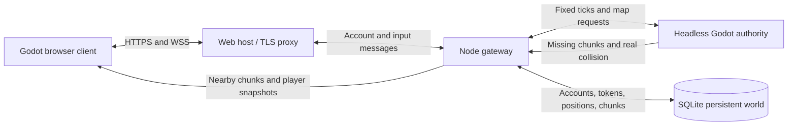

# Persistent browser world

The online client receives map chunks from the server. The server generates missing terrain, stores the resulting chunks and region records, and owns movement and character records. Two players can sign in to the same world, see each other move and reconnect at their last persisted positions.

The current online slice is shared surface exploration. Combat, loot, trading, private rooms, Sanctums, object placement and quest rewards still use the existing offline handlers. Those handlers are disabled in a public session until equivalent server transactions and instance rules are implemented. Native offline journeys remain available and their save files are separate from online account records. The browser opens the online lobby without generating an offline preview map.



## Map ownership

An endless map is generated lazily when explored. The server owns one stored world ID, seed, generator edition and content revision. A chunk contains 16 by 16 terrain cells. Each client initially receives a five-by-five window of 25 chunks, plus the real region records needed to render houses, roads, lots, town magic and site structures. Subsequent movement requests missing edge chunks and unloads distant browser data. Unknown cells remain unloaded and nonwalkable.

`server/world_worker.gd` uses the production `World` and `World.move_actor` code. `server/database.mjs` stores map chunks and regions under world/revision/coordinate keys. Revisits and server restarts read stored payloads before generating missing data. The browser's `RemoteWorld` never calls the procedural terrain or region generator. It supplies the existing renderer with decoded server records.

`MapChunkCodec` preserves vectors, rectangles, colors, bounding boxes, integer keys, StringName values and exact scalar floating-point bits across JSON. A real map regression compares the resulting cells, collision and complete region/source records with production generation, then feeds the remote adapter into the actual terrain/city renderer. Invalid packets reject before replacing the previous map.

Static art, fonts, shaders, interface resources and music remain in the browser package. Chunk streaming reduces terrain-generation work and sends nearby map data; it does not remove the initial art download. See [Web build](WEB_BUILD.md) for measured package sizes and browser evidence.

## Accounts and movement

The gateway uses Node 24, WebSockets and SQLite WAL transactions. Account passwords are salted scrypt hashes; session tokens are random opaque values stored as hashes on the server. The client remembers a resume token for the selected endpoint and does not save passwords. Public player snapshots contain names, character appearances and positions, with no passwords, tokens or inventories.

The browser sends normalized direction and an increasing input sequence. The authority moves at 20 fixed ticks per second using the same 3.8-unit walking speed and real collision as offline traversal. Client positions, time steps, inventory contents and generic save uploads are not accepted. Stale input stops movement after 500 ms; nearby-player snapshots are filtered by server positions. Menus stop that player's movement while the public world continues.

Player records persist periodically and at disconnect/graceful shutdown. Initial build, profile and inventory records are created through production character classes. The browser cannot award itself public items or upload offline progress. Inventory-changing online gameplay remains a later server-handler milestone.

## Local use

The server has no public host or domain yet. [Server setup](../server/README.md) provides local startup, configuration, recovery, protocol and Docker/Caddy deployment examples. [Browser build](WEB_BUILD.md) provides verified matching templates, repeatable export and local HTTP serving. [Online client](ONLINE_CLIENT.md) documents login, resume, authority guards and integration checks.

Run the Node gateway and serve the exported `builds/web/index.html` over HTTP for local testing. The default development connection is `ws://127.0.0.1:8080/play`. Public hosting needs HTTPS/WSS, an allowed browser origin and a durable server data volume. The deployment examples are prepared; public deployment and load capacity are not established by local two-client checks.

`tools/build_network_manifest.rb` pins protocol, generator edition, engine and the production authority/content inputs. `--check` rejects stale definitions. The server independently verifies every recorded SHA-256 before startup. Export verification checks the manifest inside the packed browser build. Existing stored worlds reject a different content revision unless the administrator explicitly adopts it after backup; seed, account and player identity stay intact. Generator migration requires its own reviewed procedure. To select an edition for a new world explicitly, build with `ruby tools/build_network_manifest.rb --generator-version 6` (or 4/5). Ordinary rebuilds and freshness checks preserve the published edition. An existing database refuses a changed edition even during content upgrade. Current public prototype worlds use edition 4. The client and worker support editions 4, 5 and 6; edition-6 chunks and sites must carry known ecology IDs and valid transitions. Adding support does not migrate an existing public world.

## Access from other machines

The gateway defaults to `0.0.0.0:8080` and the Web host to `0.0.0.0:8000`. The host proxies `/play` upgrades to the local gateway, preserving the browser Origin. This supplies a single HTTPS/WSS address behind a TLS proxy. Bind overrides remain available for private acceptance fixtures.

LAN HTTP login and play are supported by this project's single-thread launcher on private IPv4 addresses. The standard Godot shell initially refused the insecure context, and direct startup then exposed its AudioWorklet requirement. The LAN launcher keeps the real browser context unchanged, preserves WebGL/fetch/thread checks, and selects the supported silent Dummy audio driver. It displays that sound is off; sample-playback warnings are expected in that test mode. HTTPS and secure localhost retain ordinary audio. Public HTTP hosts do not receive the LAN exception, and no certificate or browser-security settings are changed.

Without a domain, a [Cloudflare Quick Tunnel](https://developers.cloudflare.com/tunnel/get-started/quick-tunnels/) supplies a temporary HTTPS address:

```sh
.tools/node/bin/node tools/serve_web.mjs
.tools/cloudflared tunnel --url http://127.0.0.1:8000 --protocol http2
```

Start the gateway with `PUBLIC_WORLD=1` and `ALLOWED_ORIGINS` set to the exact HTTPS address printed by the tunnel. Keep localhost origins only when you need local browser testing. The browser selects the matching `wss://HOST/play` automatically. No account, domain or OS certificate-trust change is needed for the Quick Tunnel. Its address lasts for that tunnel session; it is a development access path, with no production availability claim. World/account data stays in SQLite under `server/data/world.sqlite` and survives a new tunnel address.

The served browser pack and the running authority must share a content revision. Assemble the worker into a revision-specific runtime directory with `server/assemble_runtime.mjs` before launching it; this copies and verifies the complete manifest dependency closure. Subsequent source edits cannot change that running worker's inputs. Use an absolute database path so the release snapshot and future releases share the intended durable world.

## Verified browser slice

The final authority/content revision is `0fd5661110ae40af7f2ca9c25da835a3c3f4cc5266d6940796dadc77b4868ca4`, with 74 verified inputs and generator4. Four actual backend groups pass, including persistence/collision/interest, hub gate refusal/travel, interface/origin policy and independent assembled-runtime closure. Ruby manifest dependency/edition/freshness checks pass 15 assertions. Real map/codec/client queue and endpoint checks pass.

Two actual Chrome accounts joined the same durable world through LAN HTTP/WS and public HTTPS/WSS. Each received 25 server chunks with zero local terrain generation and rendered the other named player. LAN movement crossed a chunk boundary; token resume preserved the same account and position and streamed the new window. Screenshots and diagnostics are under `artifacts/web-browser/`. These browsers ran on the same Mac; a physical second-device test, other browsers, mobile performance, sustained player capacity and Docker execution remain separate.

The gateway runs from the verified runtime snapshot in `.tools/runtime-release-0fd56611`, with its database at the repository's absolute `server/data/world.sqlite`. The user test account was created and its password login verified after the gateway restart. Passwords are stored only as server hashes; temporary plaintext credential files were removed.

## Remaining multiplayer work

| Milestone | Authority boundary | Acceptance |
| --- | --- | --- |
| Shared combat and enemies | Server owns monster state, hit/ability validation, health, cooldowns and rewards; browsers render snapshots | Two players fighting the same enemy, death once, no duplicate rewards, reconnect and latency tests |
| Loot, inventory and shops | Server transactions own currency, custody, stock and equipment changes | Simultaneous purchases/pickups, full-bag rollback, stolen-property rules, persistence and no client grants |
| Interior and dungeon instances | Server assigns room/party instances and validates every entry/exit/recovery | Peers enter the same intended room, private spaces stay private, safe exit and restart recovery |
| Shared building and map changes | Server validates supports/collision/ownership and persists chunk revisions/deltas | Concurrent edits, authoritative collision, bounded streaming updates and restitution |
| Personal exploration and quests | Server records real sightings, bindings, stages and one-time rewards | Actual target agreement, old accounts, retry/deduplication and group/private completion policy |
| Production operations | Hosted HTTPS/WSS, durable backups, release/migration process and measured player budgets | Real public browser clients, restore drills and sustained concurrent load/latency measurements |

Current limits and passing checks are recorded in the linked guides and `chat.md`; a native or isolated pack pass is not evidence of browser rendering or production hosting.
