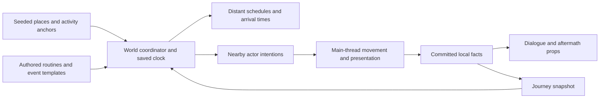

# Living-world research

Author: Wren. Date: 2026-10-13. Status: researched proposal for discussion and implementation planning. These mechanics are not implemented or adopted by this document.

The user subsequently requested coordinated implementation. The first supported slice and its validation boundaries are described in [Lives, wildlife and town episodes](LIVING_WORLD.md). The remaining mechanics and numerical research targets below remain proposals.

Add a small world coordinator that schedules local lives, keeps a few shared facts, and presents activity near the player. Residents should have something to do before the player arrives. Animals should gather around suitable places. Events should have beginnings, endings, and occasional traces. The player can enjoy these changes while continuing an ordinary expedition.

Use an in-process service owned by the current journey. Start with bounded, staggered updates on the main thread. Introduce worker tasks only for measured planning bottlenecks. The first release should work offline and stop when the game closes.

## What the current design supports

I reviewed the current source and the implemented expansion guide. The checkout is shared and other agents are still integrating features, so these observations describe the inspected revision rather than a completed playtest.

| Existing system | Opportunity and constraint |
| --- | --- |
| `World.region_at()` | Stable city, ruin, and resident IDs; two residents per town; six town archetypes and six dungeon families. Use these identities for routines and local continuity. |
| `World.load_around()` | A 5 by 5 window of 16-cell chunks; region plan cache capped at 32. Keep living activity within separate bounded limits. Never enumerate the endless world. |
| `WorldView._build_city()` | Residents have idle animations but fixed positions. Their models belong to the city-center chunk and are removed when that chunk unloads. Moving actors need independent lifetime management. |
| `Expansion.target()` | Interaction reads generated `resident.point` in the player's current region. Moving models alone would leave prompts behind; travelers crossing region boundaries also need a runtime spatial query. |
| `Expansion._choose_line()` | Authored dialogue already uses actual town/ruin context and heard history without consuming combat RNG. Extend this with supported activity and event facts. |
| `Game._update_enemies()` | Wilderness enemies activate near the player and pursue them; sanctuary protection exists. Peaceful actors need their own category and must not enter enemy counts, targeting, loot, or gate checks. |
| `Game._rebuild_navigation()` | The current shared AStar graph is rebuilt on streamed terrain changes. Ordinary routines should reuse validated local routes, keeping additional path queries rare. |
| `Journey`, `SaveStore`, Sanctum return | Saves retain actors and narrative history; the Sanctum restores a suspended journey. A living clock and state must follow these contracts explicitly. |
| Asset registry | Model and lore discovery are data driven. Metadata availability does not implement behavior, placement, or a new dialogue event. |

The main missing ingredient is continuity between activities. More spawn rolls alone would still produce encounters centered on the player.

Current source references: [world](../scripts/world.gd), [world view](../scripts/world_view.gd), [game](../scripts/game.gd), [expansion](../scripts/expansion.gd), [journey](../scripts/journey.gd), [save validation](../scripts/save_store.gd), and [implemented expansion](WORLD_EXPANSION.md). The broader [world foundation](../lore/world.md), [NPC roles](../lore/npcs.md), and [future creatures](../lore/monsters.md) remain draft lore where their mechanics are not implemented.

## Research and its application

Stephen Chenney's research describes replacing expensive out-of-view dynamics with cheaper proxy simulations. Our application is to preserve a travel destination and arrival time for a distant traveler, with detailed movement only nearby. This is a design adaptation, not a performance result for this game. [Simulation Culling and Level-of-Detail](https://pages.cs.wisc.edu/~schenney/research/culling/).

Michael Booth's Valve presentation describes population entering and leaving an active area and alternating threat buildup with relief. Borrow the restraint: allow quiet stretches and defer new encounters during existing combat. Autonomous schedules should determine what exists; pacing should govern how much new activity is presented. The presentation supplies no suitable NPC-count or timing prescription for this project. [The AI Systems of Left 4 Dead, especially slides 65 and 80–81](https://cdn.akamai.steamstatic.com/apps/valve/2009/ai_systems_of_l4d_mike_booth.pdf).

Shuo Xu's GDC session overview describes an extensible AI production pipeline, pathfinding services, and decomposition of AI into CPU tasks. Our smaller application is reusable activity definitions and centralized scheduling. I reviewed the public overview; the linked slides returned HTTP 403, and I am not claiming to have inspected its detailed implementation. [Building a Scalable AI System](https://www.gdcvault.com/play/1026968).

Sucker Punch's GDC overview describes adaptive ambience driven by time, weather, region, and game parameters. Start here for inexpensive signs of life: vary birds, distant work sounds, and town activity with the same local context as the visible actors. I reviewed the public overview; the slide PDF returned HTTP 403. [Big World, Small Team](https://www.gdcvault.com/play/1026976/Big-World-Small-Team-Designing).

Ubisoft's interview with Dominic Butler connects systemic interactions, NPC context, and persistence. Use a few shared facts across scenery and dialogue so an event has an understandable consequence. This supports the design direction, not a claim about a particular Far Cry simulation algorithm. [The Future of AI in Games](https://www.ubisoft.com/en-us/game/rainbow-six/siege/news-updates/2PYfTguMauD7UsnlhJ0u4U/the-future-of-ai-in-games-qa-with-dominic-butler).

Godot's current documentation warns that the active scene tree and shared AStar objects are not safe for concurrent worker access. Workers should operate on private plain-data inputs and return proposals for main-thread application. [Thread-safe APIs](https://docs.godotengine.org/en/stable/tutorials/performance/thread_safe_apis.html).

`WorkerThreadPool` can reduce performance when work is too small. Its tasks require eventual completion waits for cleanup. Poll completed work during play, collect it after completion, and handle outstanding tasks at teardown. Do not submit work and immediately block every frame waiting for it. [WorkerThreadPool](https://docs.godotengine.org/en/stable/classes/class_workerthreadpool.html).

MultiMesh batches draw repeated meshes efficiently, but individual instances lack independent frustum culling. Small spatial batches suit decorative insects or distant birds; named residents retain individual models and interaction identity. The tutorial carries an update notice for Godot 4.7, so benchmark the actual renderer. [Optimization using MultiMeshes](https://docs.godotengine.org/en/stable/tutorials/performance/using_multimesh.html).

The local launcher reports Godot `4.7.2.stable`. These sources establish useful patterns and engine constraints. All mechanics and numerical budgets below are Wren's proposals.

## Mechanics worth trying

| Mechanic | What the player notices or can do | Small implementation | Priority |
| --- | --- | --- | --- |
| Resident routines | A mender checks crates, the keeper tends the fountain, and a delver visits a bench. E still starts a short conversation. | Two or three reserved activity spots per town; long dwell times; simple idle/walk/act states. Keep the fountain keeper accessible. | First |
| Shared activity spots | Two residents meet, exchange a gesture, then return to their work. Their activities have a purpose. | An anchor offers a role, capacity, duration, and supported animation. Pair activity starts only when both participants arrive. | First |
| Town animals | A cat rests near the mender; chickens peck around an open yard and make room as the player passes. | Small home ranges, short validated movements, no blocking collision or combat rewards. | First |
| Local event episodes | A delivery arrives, a public supper is prepared, or surveyors compare maps. The scene finishes without assistance. | Authored setup, active, and aftermath states sharing a few stable actors and props. Participation is optional. | First |
| Contextual sound | Fountain chores, sparse animal calls, and distant conversation vary with place and activity. | Small voice cap; shared activity context; slow transitions; quiet periods. | First |
| Traveling neighbors | A Milewarden comes from an actual town, pauses at a route marker, then returns. | Site-level journey record plus a verified local path when materialized. Start within one region; wider routes require verified connections. | Next |
| Wildlife groups | Sheep graze near grass; a raccoon visits a sheltered edge. Groups have destinations beyond fleeing the player. | One leader, a few followers, home anchor, and bounded forage/rest/flee states. | Next |
| Quiet dungeon duties | Before noticing the player, a skeleton checks a doorway or an invoker repeats a lesson. | Short patrol/activity state for the existing warden; preserve aggro, total wardens, and gate rules. | Next |
| Local memory | A supper leaves a cup arrangement; a keeper mentions the actual delivery that happened. | One bounded event record feeds props and supported dialogue conditions. No notification feed. | Next |
| Soft time and weather | Towns become quieter in evening light; rain draws residents under real shelter. | Saved activity phase first; lighting/weather later after visibility and audio review. Keep exploration and recovery available. | Later |
| Unusual wildlife | Bell tortoises follow one another's rhythm beside a road. | Draft creature needs a model, locomotion, and authored sounds. Baseline peaceful observation. | Later |
| Small voluntary help | E lets the player help finish a nearby chore; the NPC can finish alone. | One explicit supported action, a short reply, and a cosmetic consequence. No daily quota or exclusive timed reward. | Later |

Cube World cat, chicken/chick, dog, horse, pig, raccoon, sheep, and wolf glTF files are present in staging. The inspected import rules select environment and characters, not the animal folder. A cat/chicken prototype can therefore start with existing source art after targeted adoption and model/animation checks. I have not verified those animals in Godot. Wildlife recordings are also staged; licensing and attribution must follow the existing importer. See [asset pipeline](ASSET_PIPELINE.md) and [world assets](../import_assets/free_packs/WORLD_ASSETS.md).

The shared facts matter more than density. A delivery should use the same origin, destination, actor IDs, and completion state in its walking scene, aftermath prop, and conversation. A staged model supplies appearance; a local record supplies meaning.

## How the coordinator stays bounded

Separate deterministic place plans, mutable living state, and rendered models. Keep routines out of generated `city.residents` dictionaries: region plans are evicted and regenerated. A living record keyed by resident ID owns current point, activity, route, and next transition. A view renders that record; interaction queries the same point.

| Detail level | Representation | Work performed |
| --- | --- | --- |
| Nearby and relevant | Individual resident or animal, current activity and position | Stagger decisions, follow cached routes, validate physical movement, animate within a cap. |
| Nearby region, outside presentation | Activity phase or journey with origin, destination, and arrival tick | Process due transitions. No meshes, per-frame movement, perception rays, or full pathfinding. |
| Distant explored place | Seeded calendar plus retained player changes and a compact recent summary | Reconstruct the present phase when queried. Avoid replaying every missed movement or cycle. |
| Unvisited country | Coordinate-derived potential plans | Allocate nothing until needed. No global census or infinite job queue. |

Use a saved integer living tick advanced from unpaused gameplay. Save its fractional accumulator too. Town phases can exist before a visible day/night system. Pause the living clock in menus, dialogue, books, inventory, grimoire, death screens, and the Sanctum. Time continues during dungeon play, so a delivery can finish while the player explores underground. The clock does not advance during application shutdown.

Baseline local episodes can be derived from `world seed + region ID + living version + cycle index`, with jitter and empty cycles. Query only the current/recent cycle needed to show its active phase or aftermath. This lets a supper begin independently of player proximity without stepping every absent NPC. Important player intervention becomes an explicit saved exception.

The first version should resolve distant episodes within their owning region. Cross-region trade, faction wars, population reproduction, and dependent global event chains require stronger persistence and ownership rules. Introduce those only if they add a useful player decision.

Schedule due work by tick and stable ID. An actor should not evaluate all possible activities every frame. Route anchors can offer a small compatible choice list. Keep an activity until completion unless danger, blocked movement, or interaction interrupts it. A reservation prevents every resident choosing the same bench.

No named actor can have two representations. Crossing a chunk boundary must retain its runtime record and independent model root; unloading a town chunk must not erase a traveler who is still nearby. Sleeping the model retains the record. On return, attach it at a valid route point outside view or continue from its visible last position. Distance hysteresis prevents repeated promotion and demotion at a boundary.

For optional worker planning, pass private snapshots of a bounded local graph and facts. Return IDs and proposed routes, never live nodes or the shared AStar object. Include journey generation and plan revision with the result. Reject stale results after load, reset, travel, or a changed route. Recheck movement and reservations on the main thread. One coordinator owns authoritative mutations.

## Starting budgets and graceful reduction

These are prototype limits to profile, not measured safe limits. Combat already consumes actor, navigation, and effects work; living activity must fit around that load.

| Added work | Initial limit |
| --- | --- |
| Individual peaceful models | 12 total near the player, including residents and animals; reduce animals first. Additional residents remain abstract or at distant anchors. |
| Abstract region working set | Current region and at most eight neighbors, created lazily. |
| Activity decisions | 2 per second per active actor, staggered; movement remains validated at the simulation step. |
| Due transitions | At most 8 small transitions per frame; each operation also has a bounded candidate count. |
| Additional route requests | At most one per frame, reuse routes until blocked or the destination changes. Keep a bounded local graph so one request cannot search the whole loaded world. |
| Event presentation | One optional episode nearby; no new presentation during combat or an existing interaction. |
| Decorative voices | Up to 4 concurrent nearby ambience voices with repetition cooldowns. |
| Worker planning, if justified | At most one outstanding living-world planning task; replace obsolete requests rather than accumulating them. |
| Timing target | Initially aim below 0.5 ms of added main-thread CPU at p95 on the target Mac, and investigate added spikes above 2 ms. Measure GPU and streaming costs separately. |

A time check between jobs is a soft scheduling bound, because a running path query cannot be preempted. Hard limits on job size, actors, search expansions, and pending requests are also necessary. Do not claim a CPU ceiling from a timer alone.

Keep authoritative event ordering deterministic. When overloaded, postpone presentation, lower animation/decision frequency, and omit disposable wildlife detail. Preserve committed facts, event IDs, and player changes. Wall-clock profiling must not decide whether an NPC acquires a permanent memory. Resume due work incrementally; never run an unbounded catch-up loop after a hitch or long dungeon visit.

Store only deviations from baseline routines and compact active/recent episodes. Expire harmless traces and bound transient history, such as the last four ambient episodes per retained region. Evict clean records that can be regenerated. Preserve player interventions separately; if those durable records grow too large, add paged storage or explicit admission limits before introducing more permanent outcomes. The endless map cannot have a bounded RAM budget and an unlimited in-memory personal history simultaneously.

## Protect the light play loop

Keep sanctuary protection, fountain recovery, dungeon access, and chest rewards stable. Peaceful residents and animals never block roads, stairs, bridges, fountains, book approaches, or gates. The player cannot accidentally target them through the current enemy selection code.

The fountain keeper's routine stays around the accessible fountain. Other residents can stop and face the player when approached. No waiting for business hours, schedule hunting, hunger upkeep, compulsory errands, map-marker flood, or reputation meters are needed for these mechanics.

An event can finish without the player and appear again in a later variation. Observing or ignoring it should both feel normal. Favor sounds, gestures, activity props, and one optional authored topic. Avoid popup invitations and rewards that encourage farming every event.

Autonomy and pacing have different jobs. A delivery can finish offscreen on schedule. If the player is fighting when its route would become visible, keep the delivery abstract and show a later trace. Never delay an already visible actor's arrival or delete it to force a preferred pace.

Example: while the player explores an Unclosed Office, a local mender receives a crate on schedule. Returning to town shows the crate in a reserved work space and the mender inspecting it. A keeper can mention that delivery because the completion is recorded. Nothing asks the player to abandon the dungeon or clear an urgent quest.

## Implementation handoff

Start with one Crossroads Town, its two existing residents, two cats or chickens, and two authored episodes: a delivery and a fountain supper. Use local validated routes and the current art. Keep the keeper near the fountain. Let events finish while the player is in a dungeon. Add biome and town variations after this loop works.

Suggested new responsibilities, to claim in `chat.md` before implementation:

| Proposed component or integration | Responsibility |
| --- | --- |
| `scripts/world_life.gd` | Logical clock, stable actor state, due queue, event facts, snapshots and validation. |
| `scripts/world_life_catalog.gd` plus configuration | Authored activities, anchors, compatible roles, phase durations, and episode definitions. Behavior types remain an explicit supported set. |
| `scripts/world_life_view.gd` | Independent peaceful actor roots, nearby model cap, visibility transitions, animation and ambient props. |
| `World` and area catalogue | Reserve reachable activity anchors and local routes without changing existing site IDs or blocked routes. |
| `Expansion` | Query live actor positions; attach event/activity context to supported authored dialogue. Bind a traveling speaker's home town explicitly instead of inferring it from current position. |
| `Game.simulate()` | Advance only the permitted living clock; apply bounded work; keep peaceful actors separate from `enemies`. |
| `Journey` and `SaveStore` | Optional versioned `progress.life` snapshot, validated IDs/counts/times, staged restore, and reset on New Game. Preserve the current version-2 generation reset behavior. |
| Sanctum return | Carry the same frozen living snapshot through return; do not overwrite it with an older suspended copy. |
| Registry and importer | Targeted animal selection and authored text discovery. Extend dialogue consumers for new conditions/events; importing metadata alone is insufficient. |

Saves without `progress.life` should receive deterministic defaults while keeping their existing terrain and progress. Adding optional living state should not trigger a new deletion of journey slots. Unknown optional ambient templates can fall back to safe idle states; malformed required state must fail validation. Future story-bearing references need an explicit compatibility policy.

Verify invariants before scaling: moving E prompts match model positions; travelers have exactly one model; chunk eviction and negative coordinates preserve identities; no activity obstructs existing routes; load order and unrelated content additions do not change combat RNG; events survive save/load without duplicate rewards; menus and Sanctum freeze time; dungeon time can finish an offscreen episode; stale worker results cannot modify a new journey.

Profile the same seeds with the coordinator disabled and enabled in a native release build. Record p50/p95/p99 frame times, added CPU, GPU time, chunk-boundary spikes, route requests, live models, pending jobs, memory, and save size. Include idle town observation, busy combat, repeated streaming boundaries, a long dungeon visit, and a sustained exploration run. Structural tests can establish correctness; native observation and playtests must establish readable activity, tolerable repetition, and a world that feels alive.

Wren completed source review and web research only. No service, mechanics, animal imports, runtime benchmark, or native playtest was performed for this proposal.
