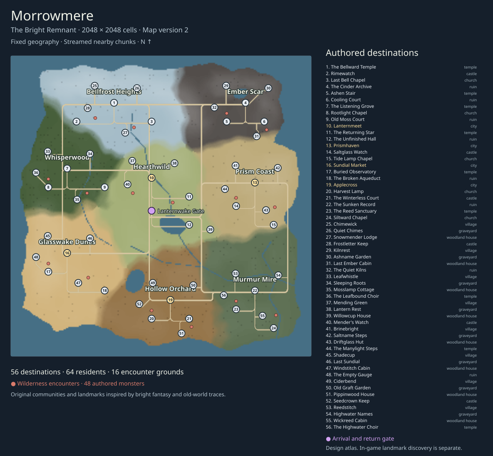

# Morrowmere: The Bright Remnant

Morrowmere is an original, finite dimension beside the endless world. Its fixed map is 2,048 by 2,048 cells, four times the initial width and sixteen times the initial area. The Inner Sanctum's study portal connects to Lanternwake, whose Portal Court leads to Morrowmere's central arrival clearing. Morrowmere's return gate and the Sanctum sigil return to Lanternwake. The original Journey portal remains the exact-return option for the suspended outside journey.

## What we learned from Ooo

Pendleton Ward describes Adventure Time's fantasy and creatures as influenced by his childhood Dungeons & Dragons games. He also explains how traces of an older civilization developed beneath a bright fantasy setting, leaving history in the background for viewers to interpret. Our design follows that structural idea: visible, cheerful places with quieter ruins beneath them. [Creator interview, Toonzone](https://animesuperhero.com/toonzone-interviews-pendleton-ward-creator-of-adventure-time/).

Ward later describes the setting as optimistic because the world remains fruitful after catastrophe. Morrowmere therefore includes orchards, shelter and communities alongside abandoned structures. This is our design inference from his interview. [Creator interview, The Beat](https://www.comicsbeat.com/interview-with-adventure-times-pendleton-ward-and-friends/).

The official Pirates of the Enchiridion game describes exploration between distinct kingdoms. We use a similar destination structure, with strongly different areas linked by a traversable road network. The names, geography and map below are original; these sources do not establish canonical coordinates for Ooo. [Official game description, Bandai Namco](https://en.bandainamcoent.eu/adventure-time/adventure-time-pirates-of-the-enchiridion).

## Fixed areas

| Area | Visible identity | Main destination | Later content direction |
| --- | --- | --- | --- |
| Bellfrost Heights | Ice and crystals | The Bellward Temple | Bell rituals, winter shelters and buried records |
| Ember Scar | Basalt and ash | The Cinder Archive | Cooling ruins, fire crafts and caldera expeditions |
| Whisperwood | Dense living forest | The Listening Grove | Strange woodland encounters and hidden paths |
| Hearthwild | Open meadows | Lanternmeet | Friendly home region, everyday errands and rebuilding |
| Prism Coast | Pale coastal ground | Prismhaven | Glass craft, tide mysteries and coastal trade |
| Glasswake Dunes | Desert and scattered stone | Sundial Market | Caravan stories and buried observatories |
| Hollow Orchard | Autumn trees | Applecross | Harvest events, old family stories and seasonal changes |
| Murmur Mire | Reeds and marsh trees | The Sunken Record | Lost records, flood history and causeway exploration |

Content version 2 has 56 authored destinations: four cities, eight villages, eight graveyards, eight isolated houses, six castles, nine temples, eight ruins and five churches. Every region has a village, a memorial ground and an isolated home as well as its larger landmarks. Sixty-two road records connect their approaches to the arrival network. Terrain and construction identities reuse existing licensed assets and the original native voxel pack. No Adventure Time artwork or character assets were imported.

## Communities and wilderness

| Area | Village | Graveyard | Isolated home | New landmark |
| --- | --- | --- | --- | --- |
| Bellfrost Heights | Chimewick | Quiet Chimes | Snowmender Lodge | Frostletter Keep |
| Ember Scar | Kilnrest | Ashname Garden | Last Ember Cabin | The Quiet Kilns |
| Whisperwood | Leafwhistle | Sleeping Roots | Mosslamp Cottage | The Leafbound Choir |
| Hearthwild | Mending Green | Lantern Rest | Willowcup House | Mender’s Watch |
| Prism Coast | Brinebright | Saltname Steps | Driftglass Hut | The Manylight Steps |
| Glasswake Dunes | Shadecup | Last Sundial | Windstitch Cabin | The Empty Gauge |
| Hollow Orchard | Ciderbend | Old Graft Garden | Pippinwood House | Seedcrown Keep |
| Murmur Mire | Reedstitch | Highwater Names | Wickreed Cabin | The Highwater Choir |

Twelve construction recipes provide two distinct layouts for each village, graveyard, woodland house, castle, temple and ruin kind. The layouts have usable courts, open house doors and gateways, resting places, books and reachable resident routes. Regional themes change their native voxel buildings. Isolated houses include snow shelters, ash-country cabins, forest cottages and reed-bank homes; they are spread across the world rather than grouped in one settlement.

The four cities and eight villages each have four named residents. Eight memorial keepers and eight isolated householders bring the total to 64 citizens. Each has a profession, a small two-dimensional roaming loop and four dialogue entries about daily work, local history and nearby landmarks. They move across open courts and house or memorial clearings rather than all following road centres. Their complete loops have supported body clearance and stay outside the conversation radius of book approaches and rest points. These are original authored people, with no generated quests or shop services attached to their dialogue.

Sixteen separate wilderness grounds contain 48 authored monsters. Their regional species include rime golems, skeletons, cinder wisps, brigands, wolves, boars, spore crawlers, shades, scarabs, frogs and footed piranhas. They enter the existing chunk-based combat, rewards and loot systems. Cities, village courts, entrances and the arrival gate have explicit hostile protection. Encounter grounds sit beyond the construction plots; residents cannot be selected as enemies.

## Organic terrain research and implementation

Map version 2 replaces the prototype's rectangular land and biome blocks with an irregular continent. An authored coast polygon and fixed noise distortion make bays and headlands. Eight geographic anchors define curved regional boundaries with blended biome palettes. Three mountain/bluff spines and three hill fields create terraced elevations. Three authored river courses connect the interior and marshes; three lakes interrupt the former open ground. Road corners are rounded, and bridge decks follow the same graded height field as the surrounding land.

Amit Patel's terrain tutorial combines noise at different frequencies, reshapes elevations and uses distance fields to constrain islands. It also explains the limits of noise alone. We use those methods for local variation while keeping important geography authored and repeatable. [Making maps with noise functions, Red Blob Games](https://www.redblobgames.com/maps/terrain-from-noise/).

Patel's Mapgen2 treats elevation, rivers and biomes as related systems and describes its terrain as designed for a game's needs. Our river and ridge placements follow that gameplay principle. They are authored channels and terrain fields; this implementation does not simulate erosion, rainfall or catchment flow. [Mapgen2, Red Blob Games](https://www.redblobgames.com/maps/mapgen2/).

Godot's FastNoiseLite provides seeded Simplex Smooth noise, fractal layers and domain distortion. Our original sampler uses explicitly seeded fields to distort coast and region coordinates, with a small elevation-control lattice for bounded slopes. [Godot FastNoiseLite documentation](https://docs.godotengine.org/en/stable/classes/class_fastnoiselite.html).

Landmarks have continuous flat foundations and gradual shoulders. The arrival clearing stays dry. Elevations use half-cell steps, and nearby terrain queries remain deterministic across chunk unloads. The sampler caches at most 128 elevation controls; it does not allocate a graph for the entire continent. Region rectangles in the JSON now serve as content-placement envelopes, with no rectangle used to draw an organic coast or biome border.

## Runtime and expansion

In a native offline journey, press H to enter the Sanctum, approach the study's Lanternwake gate and press E. In Lanternwake, follow the Worldgate Dock bridge to the Portal Court and use the Morrowmere gate. Tab opens the complete dimension atlas. Its return gate or H takes you back to Lanternwake; the Sanctum's original Journey gate returns to your suspended outside location. Re-entering Morrowmere resumes your last saved position.

`config/dimensions/morrowmere.json` defines the map extent, portal points, content-placement envelopes, geographic anchors, terrain fields, biome identities, site positions, construction/theme choices, route polylines, residents, dialogue and encounter members. `DimensionCatalog` discovers JSON definitions in `config/dimensions`; exactly one definition selects the default dimension destination in the portal network. Further dimensions can use the same provider without a switch on their names. Each definition has its own ID and map version; content version tracks additions without changing the terrain noise salt.

`config/dimension_constructions.json` holds construction profiles, modular structures and fixtures, default recipe pools and regional themes. `DimensionConstructions` checks support contact, solid footprints, reachable doors, readers, rests and resident routes before composing ordinary surface-location records. `DimensionPopulation` reads resident recipes and stable namespaced encounter IDs. New sites, inhabitants, dialogue and encounter grounds can therefore be added through data rather than additional map-specific branches.

`FiniteWorld` supplies ordinary cell and region records to the existing renderer. It loads at most 25 nearby 16-cell chunks, about 6,400 cell records in the interior. The complete dimension contains 4,194,304 possible cells, which are not allocated at startup. Map borders block movement and never invoke the endless terrain or site planner. Decoration uses a fixed dimension/version salt, so different heroes see the same geography. Hero seeds and generation editions remain associated with the original journey.

The atlas shows the complete area layout and authored roads using at most 80 by 80 terrain samples. Individual destination markers still depend on discovery. It keeps the eight area names visible, with destination names shown for hovered or selected markers so a fully discovered map remains legible. Live chunks, item custody and presentation caches must change context together when traveling.

This slice targets native offline play. It contains organic navigable terrain, biome dressing, authored communities, moving and talking citizens, fixed landmarks and combat encounters. At most 64 nearby citizen actors can exist, with only loaded homes within 56 cells considered for display. Combat spawns stay capped at two per chunk. Resident positions and dialogue progress persist in optional `progress.population`; stable combat IDs use the existing encounter ledger so defeated monsters remain defeated through saves and portal returns. Legacy saves can omit population state. Store economies and regional quests remain future work; procedural life and history generators stay disabled because their IDs and provenance refer to the endless world.

Map version 2 explicitly accepts revision-1 saves. A restored position that becomes water relocates to safe land; inventory, character, progress and the suspended outside Journey remain intact. Restoring and saving again records the canonical revision 2. Unknown, fractional and undeclared revisions reject before loading.

Public multiplayer travel needs dimension-aware authority, chunk caches, player positions and mutations keyed by world, dimension, instance and map/content version. The existing public server and deployed browser build remain on their current content release. They do not gain this portal through local source changes.

Regenerate the terrain raster with `./godot.sh --headless --script tools/export_dimension_map.gd`, then run `ruby tools/draw_dimension_map.rb` to update the standalone atlas. The renderer reads the actual sampled provider, and the drawing helper refuses a raster whose definition differs from the current map. Focused checks include `tests/test_dimension_terrain.gd`, `tests/test_finite_world.gd`, `tests/test_dimension_constructions.gd`, `tests/test_morrowmere_content.gd`, `tests/test_dimension_map.gd`, `tests/test_dimension_population.gd`, `tests/test_morrowmere_roaming.gd`, `tests/test_dimension_travel.gd` and `tests/test_dimension_revision.gd`. Native views are captured by `tools/capture_dimension.gd`; see [the gallery guide](MORROWMERE_GALLERY.md) for commands and visual acceptance scope. Packed releases must include `config/dimensions/*.json`.

## Acceptance

The focused terrain/catalog, constructions, inhabited-content, real-provider atlas, actual Game population/roaming/travel/save and revision migration fixtures pass. They cover map borders, every route centreline and grade, foundation/door/reader/rest access, all 64 authored resident routes, streaming limits, discovery preservation, fractional reloads and exact suspended overworld/dungeon/interior returns. The roaming fixture advances every actual resident through 128 quarter-second controller steps: all 64 change both horizontal axes, travel more than three cells and remain supported at terrain height. The smallest measured spans are 1.990479 and 0.995117 cells. All 48 authored monsters actually enter bounded streamed chunks. The population fixture checks real conversations, hostile targeting exclusion, projectile combat and collected loot, defeated-ID and progression persistence through fresh disk reload and the original Journey, and legacy/malformed/online guards. A temporary data-defined shrine category also composes successfully without adding a provider branch. These are focused checks, not a full combined suite.

The expanded content gallery at `artifacts/morrowmere-expanded/native-gallery.json` records 101 native views, including all 56 destinations, eight resident conversations, eight encounter grounds and observed, hovered and selected destination atlases. All 33 tracked inputs match before and after capture. Every view records renderer readiness, absence of the loading overlay and at most 25 loaded chunks. The images were reviewed for construction silhouettes, supported placement, readable dialogue and visible encounters. The subsequent three-view refresh at `artifacts/morrowmere-atlas-labels/native-gallery.json` passes the same source and readiness guards and shows all eight area names clear of the 56 known destination markers, including hovered and selected labels. This refresh is appearance evidence only; it does not accept frame timing during a potentially overlapping renderer benchmark. The original 101 images retain their recorded source snapshot.

The earlier map-version-2 gallery records 27 portal, area and terrain views and remains at `artifacts/morrowmere/native-gallery.json`; it predates content version 2. The version-1 gallery is archived separately. These focused checks and native images do not imply browser, Windows release, multiplayer or performance acceptance for the expansion.
