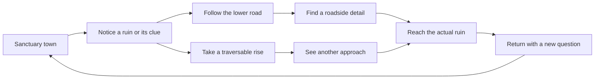

# Exploration-led world generation

Status: draft design proposal for the coding agent. All changes in this pass are documentation inside `lore/`. These rules are not yet implemented or playtested.

The goal is for a journey to offer a destination, an approach choice, a discovery, and a reason to continue or return. The [Breath of the Wild research](research/breath-of-the-wild.md) provides the source observations. The generation pipeline below is our proposed adaptation for the Endless World. Its collapsed multiverse explains different local traditions; the player's Milewarden guild gives exploration a purpose. Generation and asset terminology belongs in this author reference, not in found notes or dialogue.

## Build connected places

Keep the existing broad biome generation. Add relationships among the features within it. A ridge, town, path, ruin, and roadside book should have reasons to be near one another.

For example, a former survey district could contain a sanctuary town beside a crossing, survey marks along an old route, and a damaged office beneath a ruin. Its people reuse the old crossing and disagree about the office. The terrain supports the story, and the story explains the terrain's human use.

Use several levels of planning. These are design responsibilities, not mandatory new runtime classes.

| Level | Decide here | Examples |
| --- | --- | --- |
| District spanning several regions | Geographic character, shared past, major route relationships | A wooded survey valley or an exposed upland crossing |
| Existing region | City and ruin placement, approach choices, travel sequence | A town, two ruin entrances, and routes that link them |
| Site | Local composition and actual interactions | Ruin forecourt, roadside shelter, or fountain square |
| Chunk and cell | Rendered terrain, collisions, and environmental detail | Tree clusters, steps, bridge edges, and ground markings |

A district can cross biome boundaries. Its common history need not replace each biome's material, vegetation, or weather character. Avoid making one local wonder occur in every region of a biome.

## A discovery sequence

This is a possible travel pattern. Vary the relationship across regions. Some journeys should remain quiet. Some discoveries should be small enough to enjoy without starting another expedition.

## Terrain and route rules

Use terrain to offer choices that the current character can execute. A climbable-looking wall with no climbing support creates a false promise. A high destination needs a reachable stepped approach, road, or future explicitly supported traversal method.

Preserve a connected ordinary route from a sanctuary to each required ruin. Optional routes can change exposure, distance, view, and encounters. Their benefit need not be a permanent stat reward.

Route examples:

| Pattern | Main approach | Optional approach | What differs |
| --- | --- | --- | --- |
| Rise and road | A lower route around a rise | A reachable stepped pass | The pass offers a view; the road passes a local clue |
| Woods and clearing | A clear woodland path | An open flank through sparse trees | More shelter versus better visibility |
| Crossing and bank | A connected bridge route | A bank path that rejoins on the same accessible side | Different details without assuming swimming |
| Ruin forecourt | Broad approach to the entrance | Side approach around broken masonry | Encounter exposure and entrance reveal |

Any crossing between banks must have an actual supported crossing. A suggestive arrangement of stones is not a ford unless collision and movement make it one.

Route construction should consider slope and obstacles before decoration. Curving a path should expose a useful view, follow the ground, avoid a hazard, or lead past a meaningful detail. Random bends alone add walking time.

Reserve clearings, entry areas, bridge endpoints, and return paths before placing trees or props. If a candidate placement breaks access, repair it deterministically or use a simpler layout.

## Landmarks at different scales

| Scale | Purpose | Original setting examples |
| --- | --- | --- |
| District | Give several journeys a shared identity | An old survey ridge with a recognizable broken profile |
| Region | Suggest somewhere worth approaching | A sanctuary tower, distinctive ruin arch, or broad clearing |
| Nearby detail | Reward attention while traveling | Copper nails in an oak, marked cups, or a wrapped bell |

District silhouettes are future visual work. Their plan can be deterministic before their high-detail chunks exist. A simplified distant representation would need to agree with the real geometry when approached.

In the current camera, prioritize region and nearby scales. Keep cues distinct in silhouette and placement as well as color. Evaluate them at the game's normal zoom and resolution.

## Compose visibility from the actual camera

Separate these checks:

- A landmark lies in the rendered camera view and looks recognizable.
- Terrain or objects intentionally delay its visual reveal.
- The player can walk to it using actual movement rules.
- A combat target meets the game's line-of-sight rules.

These are different conditions. A terrain ray used for combat cannot prove that an arch reads clearly behind a tree. Cutaway materials can expose an object earlier than a layout designer intended.

Choose several approach samples along a route. Describe what should be seen at each sample, then compare rendered captures with that plan. For a first implementation, a screen-boundary reveal or change in vegetation density is easier to reason about than a distant mountain vista.

If the destination is hidden, leave a usable clue: the continuation of a road, a familiar milestone, or a glimpse of its silhouette. Evaluate returning along the route too. Do not make an approach readable from only one direction.

## Pacing depends on travel time

The inspected source uses a base movement speed of 3.8 cells per second and 64-cell regions. An uninterrupted 64-cell trip would take about 17 seconds before detours, elevation, combat, or pauses. This is an arithmetic estimate, not a measured play session.

Start with modest local journeys. Do not copy Hyrule's distances or claim that a published Nintendo rule mandates a discovery every fixed number of seconds.

Record time between noticeable features, time between meaningful decisions, encounter duration, and the longest stretch that players describe as empty. Adjust feature density and route length from those observations.

Alternate occupied and quiet stretches. A small detail can provide pacing without a fight or a quest. Keep room for movement, anticipation, and a view of the destination.

Because the current generator places a city in every region, major anchors are frequent. First improve their approaches and identities. Changing city density or enlarging travel distances is a separate decision with consequences for recovery, encounters, and streaming.

## Tie physical clues, NPCs, and books to the same facts

Assign a local history to a site before generating its associated text. Related objects can share a history without every NPC knowing all of it.

| Local record | Used by |
| --- | --- |
| Stable district, region, and site IDs | Placement, dialogue bindings, and persistence |
| Former purpose of a ruin | Architecture choices, monster flavor, and found documents |
| Current community use | Roads, repair shelters, and NPC concerns |
| Confirmed physical clue | Actual scenery and dialogue that points to it |
| Speaker's knowledge and beliefs | Reliable statements, uncertainty, and rumors |
| Story state and available interactions | Follow-up lines and supported outcomes |

Example: survey nails physically placed on a specific old oak permit a Milewarden to describe that oak. A general line about old trees needs no unique target. A letter should name a nearby ruin only when its fictional author's history links to the same site ID.

If a clue's prop or interaction is absent, omit the player instruction that depends on it. A rumor can disagree with history, but should not invent an unreachable reward. See [Procedural dialogue](procedural-dialogue.md) for bindings and continuity rules and [Books](books.md) for complete authored passages.

## Proposed deterministic generation order

1. Determine broad biome and height fields, plus the planning district for the requested coordinates.
2. Determine shared district history and major geographic relationships from stable seeds.
3. Choose candidate city and ruin sites, retaining current counts in the first milestone.
4. Plan connected main routes and suitable optional approaches using movement constraints.
5. Reserve site footprints, approaches, clearings, and intended reveal areas.
6. Assign site identities, local histories, and available content categories.
7. Place related small details and, when supported, books or NPC encounters.
8. Fill the remaining space with clustered biome decoration.
9. Check access and placement constraints. Repair or simplify failed candidates using a fixed fallback order.

Visibility checks that require rendered scenes belong in offline review or targeted validation, not necessarily in every chunk's runtime generation. The coding agent can decide which geometric approximations are cheap enough for generation.

### Ownership at boundaries

Choose each site and route segment from an owning plan, even if its footprint crosses a chunk boundary. Adjacent chunks should query that same plan. Do not independently roll both halves of a bridge or both ends of a path.

Define shared boundary crossings using a canonical ordering of the two region IDs. Decide crossings before routing each region's interior. Support negative coordinates using the same region convention as the current world.

Generate a bounded neighborhood or use coordinate-derived plans so generation order does not change results. Avoid recursively asking neighboring regions to finish their routes before each can plan its own. The first loaded chunk should not decide a district's permanent history by accident.

Keep terrain, site identity, decoration, and narrative selection in separate deterministic streams. Adding a dialogue line must not move a ruin. A content-version change can alter generated prose intentionally; it should not silently regenerate an active place's stored identity.

### Keep plans separate from progress

The same seed and content version should reproduce a place's planned layout and facts. Player progress belongs in retained state: defeated enemies, read books, visited sites, conversations, and resolved encounters.

Reloading a chunk should rebuild geometry from the plan and apply retained state. Returning after a new launch requires the future save system. Current session retention does not establish full cross-launch persistence.

## Example compositions for the four biomes

These examples are future placement briefs. Existing scenery can carry the first version; readable objects and new interactions need support.

| Biome | Initial cue and route | Discovery | Connection to local life |
| --- | --- | --- | --- |
| Greenwood | A clearing frames a ruin arch; a path passes an old oak | Survey marks on the oak and a future journal at a shelter | Foresters disagree with Milewardens about removing the nails |
| Sunlit Meadows | An open road reveals a tower; broken masonry suggests a side path | A former feast shelter and a future household book | A keeper explains the place set for an unknown traveler |
| Amber Wastes | A shaded approach passes broken containers before a ruin | A repaired cistern and a future water manual | A mender recalls an argument about a damaged cup |
| Frostlands | A sheltered road curls around a rise toward a visible arch | A wrapped bell at a future refuge and a letter kept there | A town waits for someone whose last route passed this ruin |

A cistern is initially scenery. It supplies water or recovery only after such an interaction is implemented. A letter's author, recipient, and fate stay consistent if the story later expands.

Give each composition variations in terrain, local history, and destination order. Some ruins should have different origins. Keep occasional large quiet areas so the world does not become an uninterrupted sequence of identical clue stations.

## First milestone for the coding agent

Compose one town-to-ruin journey using the current site counts and supported traversal. Reserve an ordinary accessible route, a genuine optional approach, a deliberate entrance reveal, and one local detail tied to the site's draft history.

Use existing terrain and props for the first version. Add the matching NPC hint or book after those interaction systems exist. Compare several seeds and both directions of travel before expanding the pattern library.

| Responsibility | Suggested current source touchpoint | Instruction |
| --- | --- | --- |
| Site plans, terrain, and route ownership | `scripts/world.gd` | Plan connected composition before scattered decoration |
| Movement and reachability | `scripts/grid_area.gd` | Validate against actual step and collision rules |
| Landmark rendering and local clues | `scripts/world_view.gd`, `scripts/world_voxels.gd` | Review silhouette, screen visibility, and cutaway behavior |
| Optional map presentation | `scripts/minimap.gd` | Treat discovery-based reveals as a later UX choice; preserve current atlas behavior during the first composition trial |
| Narrative context and presentation | Future dialogue/book support, with `scripts/game.gd` and `scripts/interface.gd` as current interaction/UI locations | Read facts from the same site records used for physical placement |

These are proposed touchpoints, not instructions to edit them in this lore pass. Let the coding agent select the final architecture.

## Validation brief

Structural checks should cover sanctuary-to-ruin reachability, actual differences between optional approaches, valid slopes, prop clearances, matching shared crossings, and identical plans regardless of chunk load order. Include negative coordinates, far coordinates, reloads, and district boundaries.

Narrative checks should cover real site bindings, existing clues, consistent names and histories, and omission of instructions for unsupported actions.

Rendered review should compare the intended reveal sequence with what players can actually see. Playtests should record whether players notice the cue, understand the choice, pursue the detail, remember the place, and find their way back. Connectivity tests alone cannot establish curiosity or enjoyable pacing.

The proposed milestone has no runtime or visual validation yet. This document supplies the implementation and review criteria.
